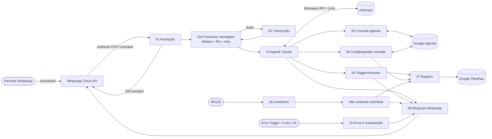
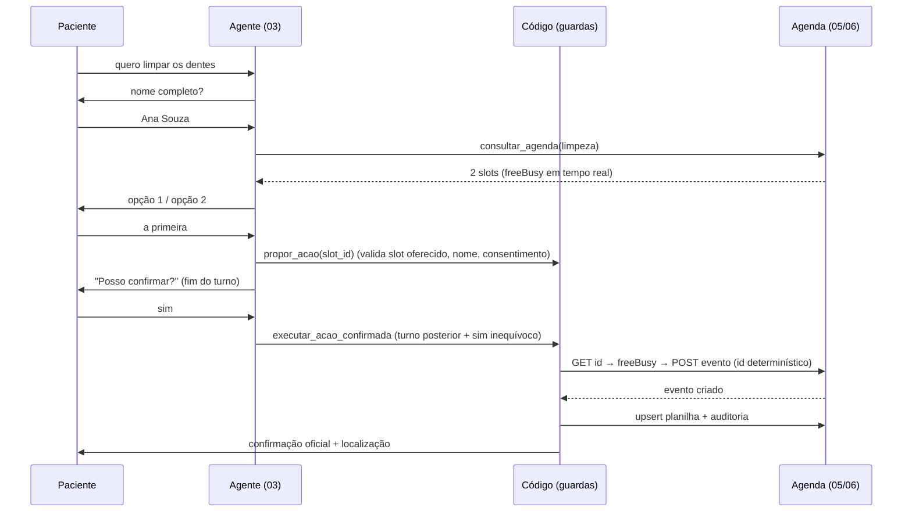

# 1. Arquitetura e desenho do fluxo

## Visão geral

## Workflows (12 = os 10 pedidos + 2 auxiliares)

| # | Workflow | Responsabilidade |
|---|---|---|
| 01 | Recepção WhatsApp | Verificação do webhook (GET), valida assinatura HMAC (POST), responde 200 e despacha cada mensagem |
| 01b | Processar mensagem *(aux.)* | Idempotência por `wamid`, fila de entrada, roteamento texto/áudio/outros, status e retentativa |
| 02 | Transcrição | Baixa a mídia na Meta, transcreve, avalia qualidade (vazio/sem fala/baixa confiança) |
| 03 | Agente Claude | Estado da conversa, consentimento, pré-triagem, loop de ferramentas, guardrails de saída, envio e persistência |
| 04 | Triagem | Registra encaminhamento humano/urgência, audita e alerta a equipe por template |
| 05 | Consulta de agenda | `freeBusy` → horários livres → 2 opções (nunca inventa horário) |
| 06 | Criação/gestão de consulta | Agendar, remarcar, cancelar, listar, confirmar presença; anti-conflito |
| 07 | Registro | Upsert em Atendimentos (valida transição de status), log de lembretes, auditoria |
| 08 | Resposta WhatsApp | Aplica a regra de janela de 24h (texto livre × template), divide mensagens longas, retentativa |
| 09 / 09b | Lembretes | Schedule 9h (+12h para falhas): consulta amanhã → deduplica → reserva → envia template → registra |
| 10 | Erros e manutenção | Error Trigger (sanitiza, grava, alerta com throttle), retentativas da fila (5 min), retenção/exclusão (3h) |

## Decisões de arquitetura (e porquê)

1. **Regras de negócio no código, não no prompt.** O LLM interpreta e conduz a conversa; *o código* garante: só oferece horário vindo da agenda, só agenda `slot_id` oferecido, só executa depois de proposta em **turno anterior** + "sim" inequívoco (`lib/booking.js`, `lib/consent.js`), bloqueia diagnóstico/medicação/preço inventado/"confirmado" sem registro (`lib/guardrails.js`).
2. **Confirmação oficial é determinística.** A mensagem "consulta confirmada" + localização é montada pelo workflow 06 com dados reais do evento criado; o texto do modelo é descartado nesse turno.
3. **Pré-triagem de urgência por regras** (`lib/triage.js`) roda *antes* do LLM — falha do modelo não impede o aviso de emergência (192/pronto-socorro).
4. **Anti-corrida no agendamento:** ID do evento no Google Agenda é determinístico (profissional + horário). Criar duas vezes → `409`; reativar evento cancelado usa `If-Match` (etag). Antes, `freeBusy` revalida contra eventos criados manualmente pela equipe.
5. **Sem dados clínicos no calendário:** título = nome + serviço; motivo só na planilha, em poucas palavras.
6. **Histórico da conversa append-only** (blocos de resposta do modelo voltam intactos; ao estourar o limite, nova conversa com resumo estruturado). Evita editar histórico, que invalida blocos de raciocínio.
7. **Uma ferramenta por rodada** (`disable_parallel_tool_use`) para manter o estado simples; limite de 6 iterações → encaminha para humano.
8. **Sessões em Google Planilhas** (pedido: stack do projeto), repartidas em 4 colunas de 45k caracteres. É suficiente para uma clínica pequena; ver limitações em `STATUS.md`.
9. **Workflows gerados por código** (`tools/`): lógica de `lib/` é a mesma testada nos testes e embutida nos Code nodes (n8n não importa arquivos locais).

## Fluxo de agendamento (sequência)

