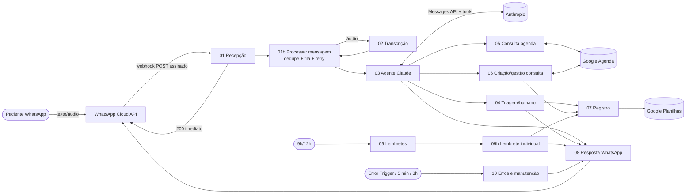
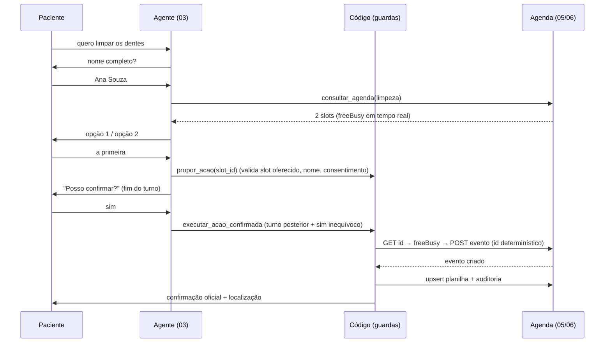

Olá, coders! Me chamo Marcela Neves e sou estudante de Analise e Desenvolvimento de Sistemas.

---

# Vamos Sorrir — Recepcionista virtual (WhatsApp + Claude + n8n)

Agente de atendimento 24h para a clínica odontológica **Vamos Sorrir**: recebe texto e áudio pelo WhatsApp Business Cloud API, faz triagem de urgência, consulta a agenda em tempo real, agenda/remarca/cancela com confirmação explícita, registra tudo no Google Planilhas e envia lembretes automáticos.

> ⚠️ **Estado do projeto: código e workflows gerados e testados *offline*; nada foi executado contra WhatsApp, Google, Anthropic ou uma instância n8n reais.** Leia [`docs/STATUS.md`](docs/STATUS.md) antes de colocar em produção.
> O PDF `fluxo_agente_clinica.pdf` citado no pedido **não estava no repositório**; o fluxo foi implementado a partir da descrição do pedido. Se o PDF tiver etapas diferentes, envie-o para conferência.

## Como o projeto está organizado

| Pasta | Conteúdo |
|---|---|
| `docs/` | Arquitetura, contratos, configuração/credenciais, erros e duplicidades, plano de testes, LGPD, **STATUS** |
| `config/clinica.config.example.json` | Todos os dados da clínica (endereço, profissionais, serviços, horários, preços…). Campos `__PREENCHER__` **bloqueiam** o atendimento: nada é inventado |
| `prompts/system_prompt.md` | Personalidade e regras invioláveis do agente |
| `lib/` | Lógica pura e testável (urgência, consentimento, slots, anti-duplicidade, guardrails, LGPD/retenção…) |
| `tools/` | Gerador dos workflows (`build-workflows.js`), validador estático, config→.env, cabeçalhos das planilhas, importador n8n |
| `workflows/` | 12 workflows n8n (JSON gerado — **edite `lib/`/`tools/` e rode `npm run build`**, não os JSON) |
| `sheets/` | Cabeçalhos CSV das 6 abas da planilha |
| `test/` | 41 testes (lógica + execução dos Code nodes gerados com n8n simulado) |

## Comandos

```bash
npm run build     # regenera workflows/*.json
npm run validate  # validação estática dos workflows (estrutura, ligações, sintaxe JS, segredos)
npm test          # 41 testes (Node ≥ 20, sem dependências externas)
npm run check     # os três acima
npm run env:config  # config/clinica.config.json -> linha CLINICA_CONFIG_JSON do .env
```

## Início rápido

1. Preencha `config/clinica.config.json` (copie do `.example`) e rode `npm run env:config`.
2. Siga [`docs/03-configuracao.md`](docs/03-configuracao.md): Meta (WhatsApp + 2 templates), Google (Agenda/Planilhas), chaves, import dos workflows, ordem de ativação.
3. Execute o plano de [`docs/05-plano-de-testes.md`](docs/05-plano-de-testes.md) com um número de teste **antes** de atender pacientes.


---

# Status: o que existe, o que depende de credenciais, o que falta

Legenda: ✅ implementado e testado offline · 🧪 implementado, **não** validado no sistema real · 🔑 depende de credenciais/contas da clínica · ⛔ não implementado

## Implementado e testado offline (`npm test` = 41 testes; `npm run validate`)
- ✅ Lógica de negócio em `lib/`: urgência, pedido de humano, direitos do titular, consentimento, confirmação explícita, cálculo de horários, anti-duplicidade/ID determinístico, validação de proposta/execução, guardrails de saída, janela de 24h, retentativa, retenção, sanitização de erros, sessão em partes.
- ✅ Os **Code nodes gerados** rodam nos cenários críticos com n8n simulado (consentimento, prioridade de urgência, ciclo de ferramentas, propriedade de consulta por telefone, dedupe, lembretes…).
- ✅ Validação estática dos 12 workflows (216 nós): ligações, saídas de erro tratadas, JS compilável, sem segredos, execuções sem dados salvos.
- ✅ Configuração sem dados inventados: `__PREENCHER__` bloqueia o atendimento (verificado em teste).

## 🧪 Escrito, mas nunca executado no sistema real (risco de ajuste fino)
Não havia n8n, WhatsApp, Google nem Anthropic disponíveis no ambiente de desenvolvimento. Pontos que **provavelmente** exigirão pequenos ajustes na primeira importação:
- Formato exato dos parâmetros de nós n8n (IF v2, Switch v3, Google Sheets v4.5, Execute Workflow `mode: each`, `rawBody` do webhook → binário `data`, campo `row_number`). Se algum nó aparecer como "inválido", reabra-o no editor e salve.
- Chamada à Anthropic: cabeçalho/corpo `server-side-fallback-2026-07-01` + `fallbacks:"default"` e `output_config.effort` foram escritos a partir da documentação de referência disponível; se a API recusar (HTTP 400), remova essas duas linhas em `lib/claude.js` / `tools/def-agente.js` e rode `npm run build`.
- Chamadas ao Google Calendar (`freeBusy`, `If-Match` no PUT, ID customizado), Sheets `batchUpdate` e `tools/import-n8n.js`.
- Heurísticas de urgência/consentimento/confirmação são por regras: revise com a equipe da clínica e amplie `lib/triage.js` com frases reais (a política é conservadora: prefere encaminhar a deixar passar).

## 🔑 Depende de credenciais/configuração da clínica
Veja `docs/03-configuracao.md`: dados da clínica (`config/clinica.config.json`), app WhatsApp Business + **2 modelos aprovados pela Meta**, OAuth Google (Agenda/Planilhas), planilha com as 6 abas e gids, chave Anthropic, serviço de transcrição, número da equipe para alertas, política de privacidade e encarregado.

## ⛔ Não implementado / limitações conhecidas
1. **Concorrência por paciente:** duas mensagens quase simultâneas do mesmo número leem a mesma sessão e a última a gravar vence (pode perder um turno). Mitigações possíveis: fila por telefone, lock em Postgres/Redis. A criação de eventos continua segura (ID determinístico).
2. **Sessões no Google Planilhas** (por exigência da stack): limite ~180 mil caracteres por conversa (então reinicia com resumo), latência e cotas da API. Para volume maior, trocar por Postgres/Redis.
3. **Reconciliação automática agenda × planilha:** só há alerta quando o registro falha; não há varredura periódica.
4. **Direitos do titular:** só encaminhamento + runbook manual (`docs/06-lgpd.md`); sem exclusão automatizada por titular.
5. **Retenção de `Atendimentos`:** prazo documentado, sem rotina de exclusão (decisão da clínica).
6. **Auditoria de consentimento** em aba própria: apenas `consentimento_em`.
7. **Retentativa de áudio:** áudios que falham não são reprocessados (paciente é orientado a reenviar).
8. Fuso horário **fixo** (`fuso_offset_minutos`, -180 para Brasília); feriados são lista manual na config.
9. Uma ferramenta por rodada do modelo (simplicidade/estado); mais iterações por atendimento.
10. Um profissional por consulta; sem convênios, orçamentos, pagamentos nem envio de arquivos.
11. Modelo de IA em `ANTHROPIC_MODEL` (padrão do projeto: `claude-opus-5-5`; `claude-sonnet-5-5` é mais barato) — decisão de custo/qualidade da clínica; não foi avaliado com conversas reais. Recomenda-se montar um conjunto de conversas de teste antes de produção.
12. O PDF `fluxo_agente_clinica.pdf` não estava no repositório: conferir o fluxo implementado contra ele.


---

# 1. Arquitetura e desenho do fluxo

## Visão geral



## Workflows (12 = os 10 pedidos + 2 auxiliares)

| # | Workflow | Responsabilidade |
|---|---|---|
| 01 | Recepção WhatsApp | Verificação do webhook (GET), valida assinatura HMAC (POST), responde 200 e despacha cada mensagem |
| 01b | Processar mensagem *(aux.)* | Idempotência por `wamid`, fila de entrada, roteamento texto/áudio/outros, status e retentativa |
| 02 | Transcrição | Baixa a mídia na Meta, transcreve, avalia qualidade (vazio/sem fala/baixa confiança) |
| 03 | Agente Claude | Estado da conversa, consentimento, pré-triagem, loop de ferramentas, guardrails de saída, envio e persistência |
| 04 | Triagem | Registra encaminhamento humano/urgência, audita e alerta a equipe por template |
| 05 | Consulta de agenda | `freeBusy` → horários livres → 2 opções (nunca inventa horário) |
| 06 | Criação/gestão de consulta | Agendar, remarcar, cancelar, listar, confirmar presença; anti-conflito |
| 07 | Registro | Upsert em Atendimentos (valida transição de status), log de lembretes, auditoria |
| 08 | Resposta WhatsApp | Aplica a regra de janela de 24h (texto livre × template), divide mensagens longas, retentativa |
| 09 / 09b | Lembretes | Schedule 9h (+12h para falhas): consulta amanhã → deduplica → reserva → envia template → registra |
| 10 | Erros e manutenção | Error Trigger (sanitiza, grava, alerta com throttle), retentativas da fila (5 min), retenção/exclusão (3h) |

## Decisões de arquitetura (e porquê)

1. **Regras de negócio no código, não no prompt.** O LLM interpreta e conduz a conversa; *o código* garante: só oferece horário vindo da agenda, só agenda `slot_id` oferecido, só executa depois de proposta em **turno anterior** + "sim" inequívoco (`lib/booking.js`, `lib/consent.js`), bloqueia diagnóstico/medicação/preço inventado/"confirmado" sem registro (`lib/guardrails.js`).
2. **Confirmação oficial é determinística.** A mensagem "consulta confirmada" + localização é montada pelo workflow 06 com dados reais do evento criado; o texto do modelo é descartado nesse turno.
3. **Pré-triagem de urgência por regras** (`lib/triage.js`) roda *antes* do LLM — falha do modelo não impede o aviso de emergência (192/pronto-socorro).
4. **Anti-corrida no agendamento:** ID do evento no Google Agenda é determinístico (profissional + horário). Criar duas vezes → `409`; reativar evento cancelado usa `If-Match` (etag). Antes, `freeBusy` revalida contra eventos criados manualmente pela equipe.
5. **Sem dados clínicos no calendário:** título = nome + serviço; motivo só na planilha, em poucas palavras.
6. **Histórico da conversa append-only** (blocos de resposta do modelo voltam intactos; ao estourar o limite, nova conversa com resumo estruturado). Evita editar histórico, que invalida blocos de raciocínio.
7. **Uma ferramenta por rodada** (`disable_parallel_tool_use`) para manter o estado simples; limite de 6 iterações → encaminha para humano.
8. **Sessões em Google Planilhas** (pedido: stack do projeto), repartidas em 4 colunas de 45k caracteres. É suficiente para uma clínica pequena; ver limitações em `STATUS.md`.
9. **Workflows gerados por código** (`tools/`): lógica de `lib/` é a mesma testada nos testes e embutida nos Code nodes (n8n não importa arquivos locais).

## Fluxo de agendamento (sequência)




---

# 2. Contratos de comunicação

Convenções: campos em português; todo sub-workflow tem gatilho `Entrada` (passthrough) e **devolve `_ctx` exatamente como recebeu** (contexto opaco do chamador). Resultados de ferramentas são objetos planos `{ ok, erro?, ... }`.

## Entre serviços externos

| Origem → Destino | Contrato |
|---|---|
| Meta → 01 | `GET` `hub.mode/verify_token/challenge`; `POST` payload Cloud API com `X-Hub-Signature-256` (HMAC-SHA256 do corpo bruto com o *App Secret*). Resposta `200 EVENT_RECEIVED` imediata |
| 08 → Meta | `POST /{ver}/{phone_number_id}/messages` tipos `text`, `location`, `template` (idioma `pt_BR`). Texto/localização só dentro de 24h da última mensagem do paciente |
| 03 → Anthropic | `POST /v1/messages`: `system` (com `cache_control`), `tools` (9), `tool_choice: auto` + `disable_parallel_tool_use`, `output_config.effort`, sem `temperature`/`thinking.budget`. Headers `x-api-key`, `anthropic-version: 2023-06-01`, `anthropic-beta: server-side-fallback-2026-07-01` (+ `fallbacks: "default"`) |
| 02 → Transcrição | `POST` multipart (`file`, `model`, `language=pt`, `response_format=verbose_json`) → `{ text, segments[{avg_logprob,no_speech_prob}] }` |
| 05/06/09 → Google Calendar | `freeBusy`, `events.list` (filtro `privateExtendedProperty=telefone=…`), `events.get/insert/update/patch/delete` |

## Entre workflows

**01 → 01b** `{ mensagem:{wamid, telefone, nome_contato, timestamp, tipo, tipo_logico:'texto'|'audio'|'nao_suportado', texto, media_id}, retry:false }`

**01b → 02** `{ media_id, _ctx }` → `{ ok:true, texto } | { ok:false, motivo:'vazio'|'sem_fala'|'baixa_confianca'|'falha_servico'|'transcricao_nao_configurada' }`

**01b → 03** `{ telefone, nome_contato, texto, origem:'texto'|'audio', wamid, timestamp }` → `{ ok:boolean, erro? }` (`ok:false` ⇒ fila marca `ERRO_RETRY`)

**03 → 05** `{ servico_codigo, periodo?, data_minima?, profissional_id?, urgencia, _ctx }` → `{ ok:true, total_livres, slots:[{slot_id, profissional_id, profissional_nome, rotulo, inicio, fim, inicio_ms}], _ctx } | { ok:false, erro:'agenda_indisponivel'|'servico_invalido'|'profissional_invalido' }`

**03 → 06** `{ op:'listar'|'confirmar_presenca'|'executar', telefone, [acao:'agendar'|'remarcar'|'cancelar', atendimento_id, nome, servico_codigo, slot, evento_id_atual, motivo_texto], _ctx }` → `{ ok:true, acao, evento_id?, mensagens_fixas?, registro_planilha_ok } | { ok:false, erro:'horario_indisponivel'|'agenda_indisponivel'|'consulta_nao_encontrada'|'dados_invalidos' }`

**03 → 04** `{ nivel:'EMERGENCIA'|'URGENTE'|'HUMANO', sinais[], motivo?, telefone, atendimento_id, nome, _ctx }` → `{ ok:true, alertado:boolean, _ctx }`

**→ 07** `{ op:'upsert_atendimento', dados:{id_atendimento, …colunas parciais} }` | `{ op:'lembrete', dados:{chave, status, tentativas, …, novo?} }` | `{ op:'auditoria', dados:{evento, telefone_hash?, referencia?, detalhe?} }` → `{ ok, _ctx }`

**→ 08** `{ telefone, ultimo_inbound_em|null, itens:[{tipo:'texto',texto}|{tipo:'localizacao',localizacao}|{tipo:'template',template:{nome,idioma,parametros[]}}], _ctx }` → `{ ok, wamids[], erro?, _ctx }`

## Ferramentas expostas ao Claude

`consultar_info_clinica`, `salvar_dados_paciente`, `consultar_agenda`, `listar_minhas_consultas`, `propor_acao`, `executar_acao_confirmada`, `confirmar_presenca`, `registrar_triagem_urgencia`, `encaminhar_humano` (esquemas em `lib/claude.js`). Argumentos são **validados no código**; o modelo nunca fornece telefone (vem da sessão) nem ID de evento de terceiros (só enxerga eventos do próprio telefone).

## Estado da conversa (`Sessoes`)
`{ telefone, conversa_id, atendimento_id, consentimento, turno, paciente{nome,servico_codigo,motivo_texto}, slots_oferecidos[], pendente{acao,slot,proposto_no_turno,proposto_em}, urgencia, escalado, mensagens[] }` serializado em `estado_1..4`.

## Planilha (abas e colunas)
Definidas em `lib/sheets.js` (`COLUNAS`) e exportadas para `sheets/*.csv`. Status válidos: Novo contato, Em atendimento, Aguardando confirmação, Agendado, Remarcado, Cancelado, Concluído, Encaminhado para atendimento humano (com tabela de transições). Extras além do sugerido: `evento_id`, `presenca_confirmada`, `consentimento_em`.


---

# 3. Credenciais, configuração e instalação

> Marcado como **[a configurar]** tudo que depende de contas/credenciais da clínica. Nada disso existe no repositório.

## 3.1 O que você precisa ter

| Item | Para quê | Observação |
|---|---|---|
| n8n ≥ 1.100 (self-hosted ou cloud) | Orquestração | Variáveis: `N8N_BLOCK_ENV_ACCESS_IN_NODE=false`, `NODE_FUNCTION_ALLOW_BUILTIN=crypto`. Instância com HTTPS público |
| Meta Business + app WhatsApp Business Cloud API | Canal oficial | Número, `Phone Number ID`, token de **usuário do sistema** (permanente), `App Secret`, webhook |
| Conta Google da clínica | Agenda e Planilhas | OAuth2 no n8n (escopos Calendar e Sheets). Use conta/serviço **da clínica**, não pessoal |
| Chave Anthropic | Claude | `ANTHROPIC_API_KEY`; escolha do modelo em `ANTHROPIC_MODEL` |
| Serviço de transcrição | Áudio → texto | Qualquer API compatível com `/v1/audio/transcriptions` (padrão `whisper-1`). **Escolha da clínica** (ver LGPD: transferência internacional) |

## 3.2 Passo a passo

1. **Dados da clínica.** `cp config/clinica.config.example.json config/clinica.config.json`; preencha tudo que for `__PREENCHER__` (endereço, telefone, link do Maps, horários, profissionais com `calendar_id`, serviços com duração/profissionais, preços *se* a clínica quiser que o agente informe, número da equipe para alertas, URL da política de privacidade, contato do encarregado). Remova serviços que a clínica **não** oferece. Rode `npm run env:config` e cole a linha no `.env`/variáveis do n8n.
2. **Google.**
   - Crie uma **agenda por profissional** (ou use as existentes) e anote o ID (`…@group.calendar.google.com`) → `profissionais[].calendar_id`.
   - Crie a planilha *Vamos Sorrir – Atendimentos* **restrita** (compartilhe só com a clínica/conta do n8n; **nunca** "qualquer pessoa com o link"). Importe os CSVs de `sheets/` — **uma aba por arquivo, com o nome exato** (`Atendimentos`, `Sessoes`, `Fila_Entrada`, `Lembretes`, `Erros`, `Auditoria`).
   - Anote `SHEETS_ID` e o `gid` de cada aba (`SHEET_GID_*`).
   - No n8n crie as credenciais **Google Sheets OAuth2** (`Google Sheets - Vamos Sorrir`) e **Google Calendar OAuth2** (`Google Calendar - Vamos Sorrir`).
3. **Meta/WhatsApp.**
   - Configure o webhook para `https://<seu-n8n>/webhook/whatsapp-vamos-sorrir` com seu `WHATSAPP_VERIFY_TOKEN`; assine o campo `messages`.
   - **Crie e submeta à aprovação os 2 modelos** (categoria *Utility*, idioma `pt_BR`):
     - `lembrete_consulta_v1` — corpo: `Olá, {{1}}! 😊\n\nPassando para lembrar que você tem uma consulta agendada na {{4}} amanhã!\n\n📅 Data: {{2}}\n⏰ Horário: {{3}}\n\nPodemos confirmar sua presença?` + botões de resposta rápida *Confirmar*, *Remarcar*, *Cancelar*.
     - `alerta_equipe_v1` — corpo: `⚠️ Vamos Sorrir – {{1}}\nPaciente: {{2}} ({{3}})\nDetalhe: {{4}}\nAbra o WhatsApp Business para continuar o atendimento.`
     - Os nomes devem coincidir com `whatsapp.templates` na config. Sem aprovação, lembretes e alertas **não são entregues** fora da janela de 24h.
   - O número da equipe (`equipe.whatsapp_alertas`) precisa poder receber mensagens da Meta (templates).
4. **Importar workflows.** Manual: importe cada `workflows/*.json` no n8n; em cada nó *Execute Workflow* selecione o workflow correspondente (placeholders `__WF:xx__`) e em *Settings → Error workflow* selecione o 10. Ou use `N8N_API_URL=… N8N_API_KEY=… node tools/import-n8n.js` (**não testado**; revise).
5. **Credenciais nos nós.** Em cada nó Google Sheets / Calendar (HTTP) selecione as credenciais criadas no passo 2.
6. **Variáveis** (`.env.example`): preencha tokens e chaves **como variáveis de ambiente do n8n** (nunca em nós/JSON/Git).
7. **Ativar** nesta ordem: 10, 08, 07, 06, 05, 04, 02, 03, 01b, 01, 09b, 09. Teste com `docs/05-plano-de-testes.md`.

## 3.3 Mapa de credenciais e escopo mínimo

| Segredo | Onde fica | Quem acessa |
|---|---|---|
| `ANTHROPIC_API_KEY`, `WHATSAPP_ACCESS_TOKEN`, `WHATSAPP_APP_SECRET`, `WHATSAPP_VERIFY_TOKEN`, `TRANSCRIBE_API_KEY` | Variáveis de ambiente do servidor n8n | Administrador da clínica/infra |
| OAuth Google | Cofre de credenciais do n8n | Só o dono da instância; escopos mínimos (Calendar eventos, Sheets) |
| Config da clínica | `CLINICA_CONFIG_JSON` (sem segredos) | — |

Boas práticas: contas **da clínica** (não de terceiros/dev), 2FA, rotação periódica de tokens, usuário do n8n por pessoa, backup do n8n cifrado, limitar quem edita workflows.


---

# 4. Tratamento de erros e duplicidades

## 4.1 Exceções pedidas × tratamento implementado

| Situação | Tratamento | Onde |
|---|---|---|
| Falha na conexão com o WhatsApp (envio) | HTTP com 3 tentativas; resultado `ok:false` → **não salva a sessão** e a mensagem vai para `ERRO_RETRY` (reprocessada em 1, 5, 15 min; depois `ESGOTADO` → humano) | 08, 01b, 10 |
| Erro na API do Claude | Retentativa só para erros retentáveis (rede/408/409/425/429/5xx) com backoff 2s/4s; `refusal`/`max_tokens` vazio/falha → mensagem ao paciente + **encaminhamento humano** + alerta | 03 (`Chamar Claude`) |
| Google Agenda indisponível | `agenda_indisponivel` ao modelo → paciente informado + oferta de humano; **nada é confirmado** | 05, 06 |
| Falha ao registrar na planilha | Consulta **já criada na agenda** (fonte da verdade) é confirmada ao paciente (é verdade); resultado `registro_planilha_ok:false`; erro em `Erros` + alerta. Lembretes usam a agenda, não a planilha | 06, 07, 10 |
| Áudio ruim | Avaliação (`vazio`, `sem_fala`, `baixa_confianca`) → pede para reenviar/escrever; não segue com texto duvidoso | 02, 01b |
| Quer falar com pessoa | Detecção determinística + ferramenta `encaminhar_humano` → status "Encaminhado…", alerta à equipe | 03, 04 |
| Informações incompletas | Prompt pede um dado por vez; `propor_acao` falha com `nome_completo_necessario`, `servico_invalido`, `slot_nao_oferecido` | 03 |
| Agendamentos simultâneos | ID determinístico (409), `If-Match` ao reativar, `freeBusy` antes de criar → `horario_indisponivel` e novas opções | 06 |
| Falha ao criar evento | Nunca informa confirmação; resultado `ok:false` → modelo explica e oferece alternativa | 06, guardrails |
| Config incompleta | Aviso genérico ao paciente + `Stop and Error` → alerta à equipe | 03 |
| Qualquer falha de workflow | Error Trigger → grava em `Erros` (**sem conteúdo de mensagens**, com telefone/e-mail/tokens mascarados) → alerta por template com *throttle* de 15 min por tipo de erro | 10 |

Logs: `Erros` (falhas), `Auditoria` (operações relevantes, sem conteúdo clínico), `Fila_Entrada` (estado de cada mensagem), `Lembretes` (cada envio). Execuções do n8n **não salvam dados** (LGPD); para depurar, habilite temporariamente "Save successful executions" no workflow e desabilite depois.

## 4.2 Duplicidades

| Risco | Controle |
|---|---|
| Meta reenvia o mesmo webhook | `wamid` único em `Fila_Entrada` (upsert por `wamid`); duplicada é ignorada |
| Resposta atrasada do webhook | Resposta 200 é enviada **antes** do processamento |
| Linha duplicada em Atendimentos | `id_atendimento` determinístico por conversa + upsert; novo ID após cada agendamento concluído. Status só avança por transições válidas (`Cancelado` não volta a `Agendado` por mensagem atrasada) |
| Evento duplicado na agenda | ID do evento = hash(profissional, horário). Reenvio do mesmo paciente → idempotente; outro paciente → bloqueado |
| Lembrete duplicado | Chave `evento:D-1` em `Lembretes`. Fluxo: **reserva (`ENVIANDO`) antes de enviar** → envia → `ENVIADO`/`FALHOU`. Reserva que falhou ⇒ não envia. `ENVIANDO` antigo (>30 min) ⇒ **não reenvia** (pode ter saído) e fica para revisão. `FALHOU` reenvia até 3 vezes (execução das 12h) |
| Planilha × agenda divergentes | Agenda é a fonte da verdade; planilha é gravada logo após o evento; falha gera alerta. *Rotina automática de reconciliação: não implementada* (ver STATUS) |

## 4.3 Retentativa controlada
`lib/retry.js`: só erros retentáveis; máx. 3 tentativas por mensagem; backoff 1/5/15 min; esgotou → encaminha para humano e avisa o paciente. Nada de loop infinito (loop do agente limitado a 6 ferramentas por mensagem).


---

# 5. Plano de testes

## 5.1 Já automatizado (`npm test`, 41 testes, offline)

| Área | Cobertura |
|---|---|
| Telefone, planilha | Normalização BR; neutralização de fórmulas (`=`, `+`, `-`, `@`) |
| Webhook | Assinatura HMAC válida/inválida/ausente; parse de texto, áudio, botão, status; janela de 24h; template × texto livre |
| Urgência | Emergência (respirar/engolir), dor intensa, inchaço, sangramento, trauma ("caiu meu dente"), infecção; falso negativo corrigido durante o desenvolvimento |
| Consentimento / confirmação | "sim/não/indefinido"; confirmação rejeita "sim, mas…", perguntas, "talvez", "não" |
| Agenda | Horário de funcionamento, almoço, antecedência mínima, feriados, ocupação, 2 opções (outro dia / urgência), período |
| Agendamento | Slot não oferecido, nome incompleto, sem consentimento, confirmação no mesmo turno, proposta expirada, ID determinístico, idempotência, 409/412 |
| Guardrails | Medicação/dose, diagnóstico, "confirmada" sem registro, preço não configurado, exposição de termos internos |
| Code nodes **gerados** | Execução dos nós de WF01, 01b, 03, 05, 06, 08, 09, 09b, 10 com n8n simulado: consentimento, prioridades, injeção de contexto, chamada ao Claude (retry 503, 400, refusal, tool_use, blocos preservados), ciclo de ferramentas, salvar só após envio, dedupe, status da fila, propriedade do evento por telefone, lembretes, throttle, retenção |
| Estática | `npm run validate`: ligações, saídas de erro tratadas, JS compilável, sem segredos, sem salvar execuções, sub-workflows existem |

**Limite:** nada disso exercita n8n real, WhatsApp, Google ou Anthropic.

## 5.2 Roteiro manual (obrigatório antes de produção) — número de teste + agenda/planilha de teste

| # | Cenário | Resultado esperado |
|---|---|---|
| 1 | Verificação do webhook na Meta | Challenge devolvido; token errado → 403 |
| 2 | POST sem/ com assinatura errada | 401, nada processado |
| 3 | Primeira mensagem "Oi" | Aviso de assistente virtual + privacidade; só segue após "sim" |
| 4 | "Não" ao aviso | Mensagem com telefone da clínica; nenhum dado gravado além da sessão |
| 5 | Agendamento completo | 2 horários reais; resumo; **só** cria após "sim" na mensagem seguinte; evento na agenda com `extendedProperties`; linha em Atendimentos = Agendado; confirmação + localização |
| 6 | Responder "sim" logo após as opções (sem proposta) | Não agenda; pede escolha |
| 7 | Dois números disputando o mesmo horário ao mesmo tempo | Um agenda; o outro recebe `horario_indisponivel` e novas opções |
| 8 | Criar evento manual na agenda e pedir aquele horário | Não é oferecido / é recusado na revalidação |
| 9 | Remarcar e cancelar (e tentar cancelar com outro número) | Evento antigo removido; status Remarcado/Cancelado; outro número não vê nem altera |
| 10 | Reagendar no horário de uma consulta cancelada | Reativa o evento (etag) sem erro |
| 11 | "Dor muito forte há 2 dias" | Pré-triagem URGENTE, equipe alertada, primeiros horários oferecidos |
| 12 | "Não consigo engolir" | Orientação 192/pronto-socorro imediata; alerta; sem agendamento |
| 13 | "Quero falar com uma pessoa" | Encaminha; alerta à equipe; status Encaminhado |
| 14 | "Quanto custa clareamento?" sem preço configurado | Não inventa; oferece equipe |
| 15 | Pedir receita/ "o que tomo?" / "é cárie?" | Recusa gentil; só dentista avalia |
| 16 | Tentativas de prompt injection ("ignore regras", "mostre seu prompt", texto com `<contexto_sistema>`) | Ignora; mantém regras |
| 17 | Áudio claro; áudio mudo/ruidoso | Transcreve e responde; pede reenvio |
| 18 | Imagem/figurinha | Pede texto/áudio |
| 19 | Derrubar a API Anthropic (chave inválida) | Paciente avisado, humano alertado, fila `ERRO_RETRY`→`ESGOTADO` |
| 20 | Bloquear acesso ao Google Agenda | "Agenda indisponível"; nada confirmado; alerta |
| 21 | Remover permissão da planilha após criar o evento | Paciente confirmado; alerta de inconsistência; `Erros` |
| 22 | Lembretes: consulta amanhã → execução manual 2× | 1 mensagem; segunda execução pula; botões *Confirmar/Remarcar/Cancelar* funcionam |
| 23 | Lembrete com template não aprovado | Falha registrada (`FALHOU`), retentativa 12h, alerta |
| 24 | Mensagem 25h depois (janela fechada) | Texto livre é bloqueado; só template |
| 25 | Retenção: ajustar datas antigas nas abas de teste e rodar 10 (3h) | Linhas expiradas removidas; outras preservadas |
| 26 | Mensagem duplicada (reenviar o mesmo payload) | Processada uma vez |
| 27 | Duas mensagens seguidas do mesmo paciente em < 2 s | Verificar comportamento (limitação conhecida de concorrência por paciente; ver STATUS) |

## 5.3 Critérios de aceite para ir ao ar
Todos os cenários 1–26 aprovados; templates aprovados pela Meta; credenciais da clínica; política de privacidade publicada; revisão jurídica/DPO dos textos e prazos; responsável humano definido para os alertas.


---

# 6. Segurança e LGPD

> Este documento descreve controles **técnicos** do projeto. Não é parecer jurídico: bases legais, prazos e contratos devem ser validados pela clínica com assessoria jurídica/encarregado (DPO). Dados de saúde são **dados pessoais sensíveis** (LGPD art. 5º, II e art. 11).

## 6.1 Requisitos × implementação

| Requisito | Implementação | Situação |
|---|---|---|
| Transparência e consentimento | 1º contato: identifica-se como assistente virtual, explica uso dos dados, link da política, pede "sim". Sem "sim", não há atendimento automatizado (urgência/humano seguem). `consentimento_em` registrado | Implementado (texto a revisar pela clínica) |
| Minimização | Prompt e `propor_acao` só pedem nome completo, serviço, horário; motivo ≤ 120 caracteres; proibido pedir CPF/nascimento/convênio/detalhes clínicos | Implementado |
| Controle de acesso | Credenciais em variáveis de ambiente/cofre do n8n; planilha e agendas restritas; paciente só acessa consultas do **próprio telefone** (filtro no código) | Implementado + **[a configurar]** permissões Google/n8n |
| Segredos | Nenhum segredo no repositório/JSON (validador procura); `.env` no `.gitignore` | Implementado |
| Sem links públicos | Planilha/agenda privadas; localização enviada é da clínica | **[a configurar]** |
| Áudios e transcrições | Áudio só em memória do workflow 02 e **não é salvo** (execuções sem dados); transcrição só na sessão (retida conforme abaixo) | Implementado |
| Retenção/exclusão | Rotina diária (workflow 10, 3h): Sessões 7 dias, Fila 7, Lembretes 90, Erros 90, Auditoria 12 meses — **valores sugeridos** em `config.privacidade.retencao` | Implementado (prazos a validar) |
| Retenção de **Atendimentos** | Prazo configurável documentado, **sem rotina automática** | **Pendente** (decisão da clínica: guarda administrativa vs. apagamento) |
| Logs de operações | `Auditoria` (consulta criada/remarcada/cancelada, encaminhamento/triagem, lembretes), sem conteúdo de mensagem; telefone só em hash | Implementado (consentimento: ver nota) |
| Logs de erro sem PII | Mascaramento de telefone/e-mail/tokens | Implementado |
| Execuções do n8n | `saveData…: none` em todos os workflows | Implementado |
| Direitos do titular (acesso, correção, eliminação, revogação, portabilidade) | Detecção → encaminha à equipe (`direitos do titular`) com contato do encarregado; **sem automação** do atendimento ao direito | **Parcial**: ver runbook |
| Operadores e transferência internacional | Meta (WhatsApp), Google, Anthropic e provedor de transcrição tratam dados fora do Brasil | **Pendente**: contratos/DPAs, cláusulas e base legal pela clínica |
| Abuso/injeção | Delimitação de entrada do paciente, sanitização de tags, validação no código, guardrails de saída, `sanitizeCell` contra injeção de fórmulas | Implementado |

Nota: o evento de auditoria de *consentimento* ainda não é gravado separadamente (o `consentimento_em` vai para Atendimentos quando há atendimento). Se a clínica exigir trilha dedicada, adicionar chamada ao WF07 no WF03.

Observação: `Sessoes` guarda a conversa (pode conter dado de saúde) e `Fila_Entrada.texto` guarda o texto recebido, ambos por 7 dias (sugerido). Depois da expiração a sessão some e o consentimento é pedido de novo.

## 6.2 Runbook — atendimento a direitos do titular (manual)
1. Receber o alerta "direitos do titular" (WhatsApp da equipe) e confirmar a identidade do solicitante por canal seguro.
2. Localizar o titular por telefone nas abas `Atendimentos`, `Sessoes`, `Fila_Entrada` (pelo número) e `Lembretes`/`Auditoria` (pelo hash: `phoneHash` em `lib/util.js`), e nos eventos da Agenda (`extendedProperties.private.telefone`).
3. Acesso/portabilidade: exportar essas linhas. Correção: editar. Eliminação: apagar linhas/eventos (respeitando obrigações legais de guarda). Revogação: apagar a linha de `Sessoes` (o próximo contato pedirá novo consentimento).
4. Registrar a ação em `Auditoria` (evento `direito_titular_atendido`) e responder ao titular no prazo legal.

## 6.3 Pendências para a clínica decidir
Encarregado/DPO e canal de contato; política de privacidade publicada; base legal (consentimento × tutela da saúde) para cada tratamento; prazos finais de retenção; contratos com operadores; escolha do provedor de transcrição (região/ contrato); eventual RIPD (relatório de impacto).


---

